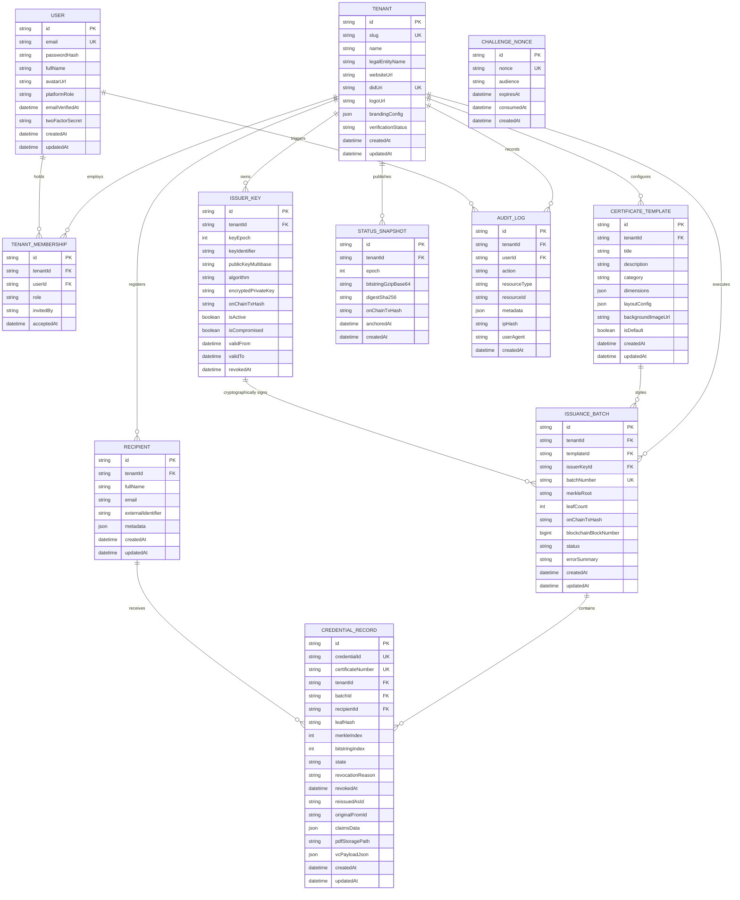

# CREDVAIL — Database Schema & Data Architecture Specification

**Project Title:** Blockchain-Verified, Privacy-Preserving Digital Credential Infrastructure  
**Document:** Database Schema & Entity Relationship Architecture  
**Document Version:** 1.0.0  
**Phase:** Phase 0 (Technical Planning)  

---

## 1. Overview & Multi-Tenant Isolation Strategy

The CREDVAIL database architecture is designed with **strict logical multi-tenant isolation**. Educational institutions, certification bodies, and corporations operate within partitioned boundaries.

### Isolation Rules
1. **Tenant Scoping:** Every institutional model (`IssuerKey`, `CertificateTemplate`, `Recipient`, `IssuanceBatch`, `CredentialRecord`, `StatusSnapshot`, `AuditLog`) contains a mandatory foreign key `tenantId` referencing `Tenant(id)`.
2. **Query Filtering:** All database access logic within application repositories automatically injects `tenantId` into where clauses.
3. **Compound Indexes:** High-throughput queries utilize compound indexes prefixed by `tenantId` (e.g., `@@index([tenantId, certificateNumber])`).
4. **Referential Integrity & Cascades:** Deleting a tenant cleanly cascades to internal operational records while preserving immutable audit logs for compliance.

---

## 2. Entity Relationship Diagram



---

## 3. Data Dictionary & Field Specifications

### 3.1 Tenant (`tenants`)
| Field | Type | Modifiers | Description |
| :--- | :--- | :--- | :--- |
| `id` | `UUID` | Primary Key, Default `gen_random_uuid()` | Internal unique identifier. |
| `slug` | `VARCHAR(64)` | Unique, Indexed | URL-safe identifier (e.g., `mit-engineering`). |
| `name` | `VARCHAR(255)` | Not Null | Display name of the institution. |
| `legalEntityName` | `VARCHAR(255)` | Not Null | Registered legal entity name for trust verification. |
| `websiteUrl` | `VARCHAR(512)` | Not Null | Official institutional web domain. |
| `didUri` | `VARCHAR(255)` | Unique, Not Null | W3C DID string: `did:web:<domain>:tenants:<slug>`. |
| `logoUrl` | `VARCHAR(1024)` | Nullable | Public URL for institutional crest/logo. |
| `brandingConfig` | `JSONB` | Default `'{}'` | Theme colors (`primaryColor`, `accentColor`, font families). |
| `verificationStatus` | `ENUM` | Default `'PENDING'` | `UNVERIFIED`, `PENDING`, `VERIFIED`, `SUSPENDED`. |

```prisma
model Tenant {
  id                 String             @id @default(uuid())
  slug               String             @unique
  name               String
  legalEntityName    String
  websiteUrl         String
  didUri             String             @unique
  logoUrl            String?
  brandingConfig     Json               @default("{}")
  verificationStatus VerificationStatus @default(PENDING)
  memberships        TenantMembership[]
  issuerKeys         IssuerKey[]
  templates          CertificateTemplate[]
  recipients         Recipient[]
  batches            IssuanceBatch[]
  credentials        CredentialRecord[]
  statusSnapshots    StatusSnapshot[]
  auditLogs          AuditLog[]
  createdAt          DateTime           @default(now())
  updatedAt          DateTime           @updatedAt
}
```

### 3.2 User (`users`) & TenantMembership (`tenant_memberships`)
```prisma
model User {
  id                 String             @id @default(uuid())
  email              String             @unique
  passwordHash       String
  fullName           String
  avatarUrl          String?
  platformRole       PlatformRole       @default(USER)
  emailVerifiedAt    DateTime?
  twoFactorSecret    String?
  memberships        TenantMembership[]
  auditLogs          AuditLog[]
  createdAt          DateTime           @default(now())
  updatedAt          DateTime           @updatedAt
}

model TenantMembership {
  id                 String             @id @default(uuid())
  tenantId           String
  userId             String
  role               TenantRole         @default(READ_ONLY_STAFF)
  invitedBy          String?
  acceptedAt         DateTime?
  tenant             Tenant             @relation(fields: [tenantId], references: [id], onDelete: Cascade)
  user               User               @relation(fields: [userId], references: [id], onDelete: Cascade)

  @@unique([tenantId, userId])
}
```

### 3.3 IssuerKey (`issuer_keys`)
| Field | Type | Modifiers | Description |
| :--- | :--- | :--- | :--- |
| `id` | `UUID` | Primary Key | Key record identifier. |
| `tenantId` | `UUID` | Foreign Key (`Tenant.id`) | Owning institution. |
| `keyEpoch` | `INTEGER` | Not Null, Default `1` | Sequential key version counter. |
| `keyIdentifier` | `VARCHAR(255)` | Not Null | Fragment matching DID document (e.g. `key-1`). |
| `publicKeyMultibase` | `TEXT` | Not Null | Multibase-encoded public key representation. |
| `algorithm` | `VARCHAR(64)` | Default `'ECDSA-P256'` | Supported: `ECDSA-P256`, `ECDSA-SECP256K1`. |
| `encryptedPrivateKey`| `TEXT` | Nullable | AES-256-GCM encrypted private key (zero-trust KMS envelope). |
| `onChainTxHash` | `VARCHAR(66)` | Nullable | Ethereum transaction anchoring public key fingerprint. |
| `isActive` | `BOOLEAN` | Default `true` | Indicates current active issuance signing key. |
| `isCompromised` | `BOOLEAN` | Default `false` | Distinguishes emergency compromise from planned rotation. |
| `validFrom` | `TIMESTAMPTZ` | Default `now()` | Start of cryptographic validity epoch. |
| `validTo` | `TIMESTAMPTZ` | Nullable | Scheduled expiration timestamp. |
| `revokedAt` | `TIMESTAMPTZ` | Nullable | Timestamp if terminated prematurely. |

```prisma
model IssuerKey {
  id                  String    @id @default(uuid())
  tenantId            String
  keyEpoch            Int       @default(1)
  keyIdentifier       String
  publicKeyMultibase  String
  algorithm           String    @default("ECDSA-P256")
  encryptedPrivateKey String?
  onChainTxHash       String?
  isActive            Boolean   @default(true)
  isCompromised       Boolean   @default(false)
  validFrom           DateTime  @default(now())
  validTo             DateTime?
  revokedAt           DateTime?
  tenant              Tenant    @relation(fields: [tenantId], references: [id], onDelete: Cascade)
  batches             IssuanceBatch[]

  @@unique([tenantId, keyEpoch])
}
```

### 3.4 CertificateTemplate (`certificate_templates`)
| Field | Type | Modifiers | Description |
| :--- | :--- | :--- | :--- |
| `id` | `UUID` | Primary Key | Template identifier. |
| `tenantId` | `UUID` | Foreign Key (`Tenant.id`) | Owning tenant. |
| `title` | `VARCHAR(255)` | Not Null | Template name (e.g., "Dean's Honor Award"). |
| `category` | `VARCHAR(64)` | Not Null | Course Completion, Event, Internship, Workshop, etc. |
| `dimensions` | `JSONB` | Not Null | `{ width: 1122, height: 793, orientation: "landscape" }`. |
| `layoutConfig` | `JSONB` | Not Null | Coordinate map of placeholders, fonts, alignment, QR position. |
| `backgroundImageUrl` | `TEXT` | Nullable | High-resolution background certificate vector/raster image. |
| `isDefault` | `BOOLEAN` | Default `false` | Tenant's default template. |

```prisma
model CertificateTemplate {
  id                 String          @id @default(uuid())
  tenantId           String
  title              String
  description        String?
  category           String
  dimensions         Json
  layoutConfig       Json
  backgroundImageUrl String?
  isDefault          Boolean         @default(false)
  tenant             Tenant          @relation(fields: [tenantId], references: [id], onDelete: Cascade)
  batches            IssuanceBatch[]
  createdAt          DateTime        @default(now())
  updatedAt          DateTime        @updatedAt
}
```

### 3.5 Recipient (`recipients`)
| Field | Type | Modifiers | Description |
| :--- | :--- | :--- | :--- |
| `id` | `UUID` | Primary Key | Recipient entity identifier. |
| `tenantId` | `UUID` | Foreign Key (`Tenant.id`) | Scoped tenant. |
| `fullName` | `VARCHAR(255)` | Not Null | Recipient's legal/display name. |
| `email` | `VARCHAR(255)` | Not Null | Primary contact/delivery email. |
| `externalIdentifier`| `VARCHAR(128)`| Nullable | Student ID, employee number, or registration ID. |
| `metadata` | `JSONB` | Default `'{}'` | Custom dynamic fields parsed from CSV/XLSX. |

```prisma
model Recipient {
  id                 String             @id @default(uuid())
  tenantId           String
  fullName           String
  email              String
  externalIdentifier String?
  metadata           Json               @default("{}")
  tenant             Tenant             @relation(fields: [tenantId], references: [id], onDelete: Cascade)
  credentials        CredentialRecord[]
  createdAt          DateTime           @default(now())
  updatedAt          DateTime           @updatedAt

  @@unique([tenantId, email])
}
```

### 3.6 IssuanceBatch (`issuance_batches`)
| Field | Type | Modifiers | Description |
| :--- | :--- | :--- | :--- |
| `id` | `UUID` | Primary Key | Unique batch identifier. |
| `tenantId` | `UUID` | Foreign Key (`Tenant.id`) | Issuer tenant. |
| `templateId` | `UUID` | Foreign Key (`CertificateTemplate.id`) | Layout template utilized. |
| `issuerKeyId` | `UUID` | Foreign Key (`IssuerKey.id`) | Key epoch used for signing. |
| `batchNumber` | `VARCHAR(64)` | Unique per Tenant | Identifier: `BATCH-2026-000001`. |
| `merkleRoot` | `VARCHAR(66)` | Nullable | $32$-byte hex string (`0x...`) anchoring all leaves. |
| `leafCount` | `INTEGER` | Default `0` | Number of verified certificates in batch. |
| `onChainTxHash` | `VARCHAR(66)` | Nullable | Ethereum transaction hash anchoring `merkleRoot`. |
| `blockchainBlockNumber`| `BIGINT` | Nullable | Confirmed Ethereum block number. |
| `status` | `ENUM` | Default `'DRAFT'` | `DRAFT`, `PROCESSING`, `GENERATED`, `ANCHORED`, `FAILED`. |

```prisma
model IssuanceBatch {
  id                    String              @id @default(uuid())
  tenantId              String
  templateId            String
  issuerKeyId           String
  batchNumber           String
  merkleRoot            String?
  leafCount             Int                 @default(0)
  onChainTxHash         String?
  blockchainBlockNumber BigInt?
  status                BatchStatus         @default(DRAFT)
  errorSummary          String?
  tenant                Tenant              @relation(fields: [tenantId], references: [id], onDelete: Cascade)
  template              CertificateTemplate @relation(fields: [templateId], references: [id])
  issuerKey             IssuerKey           @relation(fields: [issuerKeyId], references: [id])
  credentials           CredentialRecord[]
  createdAt             DateTime            @default(now())
  updatedAt             DateTime            @updatedAt

  @@unique([tenantId, batchNumber])
}
```

### 3.7 CredentialRecord (`credential_records`)
| Field | Type | Modifiers | Description |
| :--- | :--- | :--- | :--- |
| `id` | `UUID` | Primary Key | Internal record ID. |
| `credentialId` | `VARCHAR(255)`| Unique, Indexed | W3C VC URI (e.g., `urn:uuid:...`). |
| `certificateNumber`| `VARCHAR(64)` | Unique, Indexed | Human certificate number (e.g., `CREDVAIL-2026-000001`). |
| `tenantId` | `UUID` | Foreign Key (`Tenant.id`) | Issuing institution. |
| `batchId` | `UUID` | Foreign Key (`IssuanceBatch.id`) | Parent batch. |
| `recipientId` | `UUID` | Foreign Key (`Recipient.id`) | Associated holder. |
| `leafHash` | `VARCHAR(66)` | Not Null | Keccak-256 hash in Merkle Tree. |
| `merkleIndex` | `INTEGER` | Not Null | Leaf index in the Merkle Tree. |
| `bitstringIndex` | `INTEGER` | Not Null | Offset bit in W3C Bitstring Status List. |
| `state` | `ENUM` | Default `'ISSUED'` | `ISSUED`, `SUSPENDED`, `REVOKED`. |
| `revocationReason` | `TEXT` | Nullable | Human/machine-readable justification. |
| `claimsData` | `JSONB` | Not Null | Plain unblinded claims (name, course, date, grade). |
| `pdfStoragePath` | `TEXT` | Nullable | S3/Object storage key for generated PDF. |
| `vcPayloadJson` | `JSONB` | Not Null | Full W3C VC 2.0 signed document with cryptographic proof. |

```prisma
model CredentialRecord {
  id                String          @id @default(uuid())
  credentialId      String          @unique
  certificateNumber String          @unique
  tenantId          String
  batchId           String
  recipientId       String
  leafHash          String
  merkleIndex       Int
  bitstringIndex    Int
  state             CredentialState @default(ISSUED)
  revocationReason  String?
  revokedAt         DateTime?
  reissuedAsId      String?
  originalFromId    String?
  claimsData        Json
  pdfStoragePath    String?
  vcPayloadJson     Json
  tenant            Tenant          @relation(fields: [tenantId], references: [id], onDelete: Cascade)
  batch             IssuanceBatch   @relation(fields: [batchId], references: [id], onDelete: Cascade)
  recipient         Recipient       @relation(fields: [recipientId], references: [id])
  createdAt         DateTime        @default(now())
  updatedAt         DateTime        @updatedAt

  @@index([tenantId, certificateNumber])
  @@index([tenantId, state])
}
```

### 3.8 StatusSnapshot (`status_snapshots`), ChallengeNonce & AuditLog
```prisma
model StatusSnapshot {
  id                  String    @id @default(uuid())
  tenantId            String
  epoch               Int
  bitstringGzipBase64 String
  digestSha256        String
  onChainTxHash       String?
  anchoredAt          DateTime?
  tenant              Tenant    @relation(fields: [tenantId], references: [id], onDelete: Cascade)
  createdAt           DateTime  @default(now())

  @@unique([tenantId, epoch])
}

model ChallengeNonce {
  id         String    @id @default(uuid())
  nonce      String    @unique
  audience   String
  expiresAt  DateTime
  consumedAt DateTime?
  createdAt  DateTime  @default(now())

  @@index([nonce, expiresAt])
}

model AuditLog {
  id           String   @id @default(uuid())
  tenantId     String?
  userId       String?
  action       String
  resourceType String
  resourceId   String
  metadata     Json     @default("{}")
  ipHash       String
  userAgent    String?
  createdAt    DateTime @default(now())
  tenant       Tenant?  @relation(fields: [tenantId], references: [id], onDelete: SetNull)
  user         User?    @relation(fields: [userId], references: [id], onDelete: SetNull)

  @@index([tenantId, createdAt])
}
```

---

## 4. Indexing & Partitioning Strategy

For scale ($> 100,000$ certificates per tenant):
1. **B-Tree Indices:**
   - `idx_credentials_tenant_cert_num`: `(tenantId, certificateNumber)`
   - `idx_credentials_lookup`: `(credentialId)`
   - `idx_batches_tenant_status`: `(tenantId, status)`
   - `idx_challenge_freshness`: `(nonce, expiresAt, consumedAt)`
2. **Table Partitioning (Future Proofing):**
   - `credential_records` and `audit_logs` are structurally prepared for PostgreSQL range partitioning by `createdAt` (yearly partitions) or list partitioning by `tenantId`.
