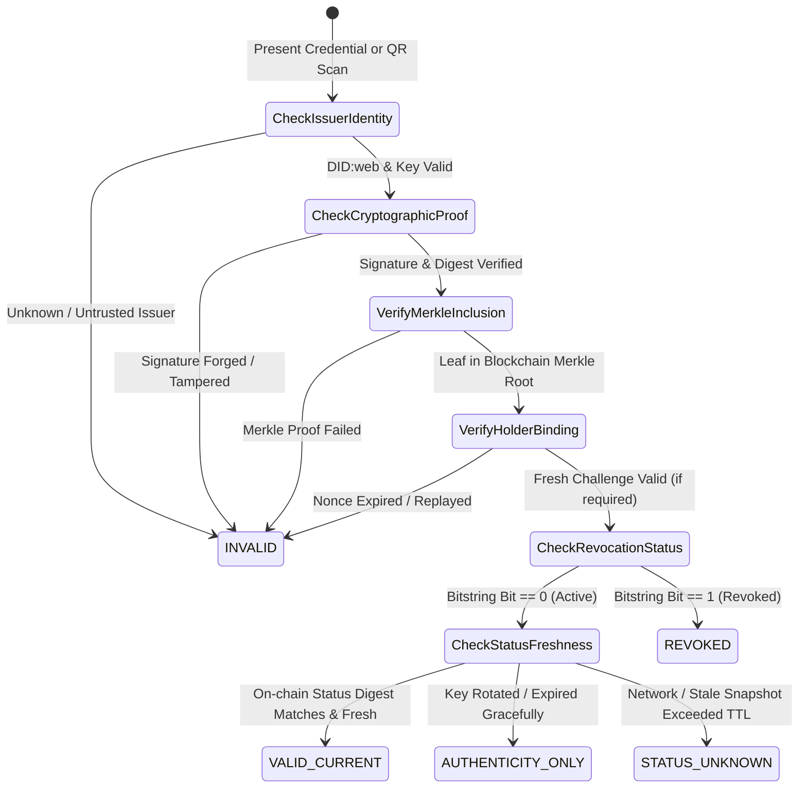

# CREDVAIL — Phase 0: Requirements Audit and Technical Architecture

**Project Title:** Blockchain-Verified, Privacy-Preserving Digital Credential Infrastructure  
**Project Category:** Multi-Tenant SaaS Platform / Blockchain / Cybersecurity / Digital Credential Management  
**Current Phase:** PHASE 0 — Requirements Audit and Technical Planning  
**Status:** Completed and Pending User Approval  
**Timestamp:** November 2026  

---

## 1. Executive Summary & Thesis Problem Statement

### 1.1 The Problem
Traditional educational and vocational credentialing suffers from three fundamental structural vulnerabilities:
1. **Forgery & Tampering:** Static PDFs and paper certificates are easily altered using standard graphic software with minimal detection risk unless verified via slow, manual registrar channels.
2. **Privacy Invasion (Over-Disclosure):** When a holder presents a certificate to prove a single claim (e.g., degree completion or specific certification), they are forced to disclose extraneous personal data (e.g., student ID, birthdate, full transcript, GPA, disciplinary notes).
3. **Revocation & Key Governance Blindspots:** Centralized verification APIs create single points of failure, privacy tracking of holders, and vendor lock-in. Existing blockchain-anchored credentials often treat revocation as an afterthought or leak metadata on-chain, and fail to distinguish between normal cryptographic key rotation and active key compromise, resulting in either stale validation or wholesale historical credential invalidation.

### 1.2 The CREDVAIL Solution
CREDVAIL provides a dual-layer institutional credential infrastructure:
- **Human-Centric Layer:** A multi-tenant SaaS dashboard for educational institutions and corporate issuers providing custom visual template design, CSV/XLSX bulk ingestion, collision-safe certificate numbering, and print-ready PDF generation with embedded QR codes.
- **Machine-Verifiable Cryptographic Layer:** A W3C Verifiable Credentials Data Model 2.0 implementation utilizing W3C DID:web for institutional identity, ECDSA-SD-2023 for zero-knowledge selective disclosure, W3C Bitstring Status Lists anchored to Ethereum Sepolia via cryptographic Merkle trees, and a freshness-aware verification engine that guarantees non-repudiation, holder privacy, and real-time validity checks without on-chain PII exposure.

---

## 2. Comprehensive Requirements Audit: Functional Modules A through M

CREDVAIL's architecture maps each required functional module to concrete components, database entities, and cryptographic protocols:

### MODULE A — Authentication and Institution Management
- **Capabilities:** User signup, secure login (Argon2id), organization registration, profile branding, institution verification status, user invitations, and tenant isolation.
- **Access Control:** Platform roles (`SUPER_ADMIN`, `USER`) and institution-level roles (`ORG_OWNER`, `INSTITUTION_ADMIN`, `CERTIFICATE_ISSUER`, `TEMPLATE_DESIGNER`, `READ_ONLY_STAFF`).
- **Isolation:** Strict tenant boundary enforcement across all entities.

### MODULE B — Certificate Template Management
- **Capabilities:** Browse, select, design, and configure certificate templates.
- **Dynamic Placeholders:** `{{recipient_name}}`, `{{certificate_number}}`, `{{course_name}}`, `{{organization_name}}`, `{{issue_date}}`, `{{completion_date}}`, `{{grade}}`, `{{instructor_name}}`, `{{verification_url}}`.
- **Customization:** Page dimensions, landscape/portrait orientation, logos, signatures, typography, and QR code placement.
- **Categories:** Course Completion, Event Participation, Internship, Training, Achievement, Appreciation, Membership, Workshop, Competition, and Custom.

### MODULE C — Bulk Certificate Generation
- **Capabilities:** CSV/XLSX ingestion, formula injection sanitization, column mapping, required-field validation, duplicate detection, atomic background generation, and collision-safe numbering (e.g., `CREDVAIL-2026-000001`).
- **Outputs:** High-resolution individual print-ready PDFs, W3C VCs, unique QR codes, and bulk ZIP streaming download.

### MODULE D — Digital Certificate Dashboard
- **Capabilities:** Real-time visibility into total, active, revoked, and pending certificates.
- **Management:** Search, multi-attribute filtering, batch tracking, individual PDF download, and audit trails.

### MODULE E — Digital Credential Issuance
- **Capabilities:** W3C Verifiable Credentials Data Model 2.0 documents signed by tenant active key epoch using `did:web` and ECDSA-SD-2023.

### MODULE F — Blockchain Infrastructure
- **Capabilities:** Ethereum Sepolia smart contract registry (`CredvailRegistry.sol`) anchoring batch Merkle roots ($O(1)$ scaling), key epoch fingerprints, and status list digest commitments. Zero PII on-chain.

### MODULE G — QR-Based Verification
- **Capabilities:** Static lookup QR embedding verification URLs (`https://credvail.io/verify/:credentialId`) directing verifiers to machine and human-readable trust assessment.

### MODULE H — Holder Digital Wallet
- **Capabilities:** Browser-based offline wallet using IndexedDB and WebCrypto API non-exportable device keys (`did:key`). View, organize, search, and present credentials.

### MODULE I — Selective Disclosure
- **Capabilities:** Cryptographic disclosure using `ecdsa-sd-2023`. Blinded claim proof generation concealing non-requested sensitive fields.

### MODULE J — Fresh Challenge and Holder Binding
- **Capabilities:** Verifier-issued CSPRNG challenge nonces with 5-minute TTL, audience domain binding, single-use consumption tracking, and holder key signature.

### MODULE K — Revocation and Reissuance
- **Capabilities:** W3C Bitstring Status List v1.0 tracking active/revoked bits. Periodic off-chain snapshot publishing with on-chain SHA-256 digest anchoring. Lineage tracking for reissued credentials.

### MODULE L — Freshness-Aware Verification
- **Capabilities:** 5-state machine-readable verification outcomes (`VALID_CURRENT`, `REVOKED`, `AUTHENTICITY_ONLY`, `STATUS_UNKNOWN`, `INVALID`) evaluating signature validity, Merkle inclusion, key epoch status, and status list freshness.

### MODULE M — Audit and Analytics
- **Capabilities:** Comprehensive tracking of issuance volume, verification attempts, key rotations, and revocations without storing sensitive credential claims or private keys in logs.

---

## 3. Thesis Research Contribution & Hypotheses

### 2.1 Research Novelty
The core academic contribution of this thesis is:
> **"A Freshness-Aware, Multi-Tenant Issuer-Key Governance and Dual-Layer Blockchain-Anchored Status Verification Framework."**

Existing solutions (such as Blockcerts or standard OpenCerts) either write individual hashes on-chain (incurring $O(N)$ prohibitive gas costs) or publish static Merkle roots without real-time, privacy-preserving revocation status and cryptographic key lifecycle modeling. 

CREDVAIL introduces:
1. **Dual-Layer Status Anchoring:** Individual certificate integrity is bound to an issuance batch Merkle root ($O(1)$ on-chain cost for $N$ certificates), while dynamic lifecycle status (active, suspended, revoked) is tracked via off-chain W3C Bitstring Status Lists whose periodic cryptographic commitments (digest + epoch) are anchored on-chain.
2. **Key Epoch & Compromise Disambiguation:** A governance model that distinguishes benign key rotation (preserving historical credential validity signed during active key epochs) from key compromise (triggering selective invalidation).
3. **Freshness-Aware Machine States:** A 5-state formal verification model (`VALID_CURRENT`, `REVOKED`, `AUTHENTICITY_ONLY`, `STATUS_UNKNOWN`, `INVALID`) providing mathematical guarantees against stale cache poisoning and replay attacks.

### 2.2 Formal Hypotheses
- **H1 (Scalability):** Batch Merkle root anchoring combined with Bitstring status digests achieves $\ge 98\%$ lower Ethereum gas expenditure compared to per-certificate on-chain transaction models while preserving independent proof of existence.
- **H2 (Privacy Preservation):** ECDSA-SD-2023 selective disclosure reduces holder presentation payload size by at least $40\%$ compared to full credential disclosure while maintaining cryptographic non-repudiation and zero knowledge of concealed claims.
- **H3 (Freshness Resilience):** Enforcing cryptographic challenge nonces and status snapshot epoch thresholds reduces replay and stale-verification attack success rates to $0.0\%$.

---

## 3. End-to-End System Architecture

```mermaid
flowchart TD
    subgraph Institutional_Tenant ["Institutional Tenant (Issuer)"]
        A[CSV / XLSX Data Ingestion] --> B[Sanitization & Schema Validation]
        T[Template Designer] --> C[PDF & QR Generator]
        B --> C
        B --> D[W3C VC 2.0 Generator]
        K[Issuer Key Manager / HSM / KMS] -->|Sign Claims| D
        D --> E[Batch Merkle Tree Builder]
        C --> F[Encrypted Asset Storage (PDF)]
        D --> G[Off-chain Credential Store]
    end

    subgraph Blockchain_Layer ["Ethereum Sepolia Layer"]
        E -->|Publish Merkle Root & Batch ID| SC1[CredvailRegistry.sol]
        K -->|Register Key Epoch & Fingerprint| SC1
        SL[Bitstring Status List Manager] -->|Anchor Status Digest & Epoch| SC1
    end

    subgraph Holder_Layer ["Holder Digital Wallet"]
        G -.->|Claim Credential| HW[Browser Wallet / IndexedDB]
        HW -->|Generate Device Key| WKC[WebCrypto API Non-Exportable Key]
        HW -->|Selective Disclosure Engine| SD[ECDSA-SD-2023 Presentation]
    end

    subgraph Verifier_Layer ["Public & Enterprise Verifier"]
        QR[Scanned Certificate QR] --> VE[Freshness-Aware Verification Engine]
        V_REQ[Verifier Challenge Nonce] --> SD
        SD --> VE
        VE -->|Query Root & Key Epoch| SC1
        VE -->|Fetch Status Bitstring Snapshot| SL
        VE --> RES["Verification Result (VALID_CURRENT / REVOKED / etc.)"]
    end
```

### 3.1 Verification State Machine



---

## 4. Cryptographic Profile & Standards Conformance

| Standard / Component | Specification / Profile | Justification & Compatibility |
| :--- | :--- | :--- |
| **Credential Data Model** | W3C Verifiable Credentials Data Model v2.0 | Standardized JSON-LD model, explicit `@context`, credentialSubject, evidence, and status structures. |
| **Issuer Identity** | W3C `did:web` (e.g., `did:web:credvail.io:tenants:harvard`) | Decentralized identifier bound to standard HTTPS domain governance without expensive on-chain DID registrations. |
| **Holder Identity & Binding** | W3C `did:key` (ephemeral or non-exportable WebCrypto Ed25519 or P-256) | Binds selective disclosure presentations to a physical holder device using challenge-response nonces. |
| **Selective Disclosure Cryptosuite** | `ecdsa-sd-2023` (NIST P-256 / secp256k1) using HMAC-SHA256 claim blinding | Interoperable W3C candidate recommendation allowing individual claim disclosure without leaking sibling claims. |
| **Integrity Anchoring** | RFC 6962 / Deterministic Keccak-256 Merkle Tree | Compatible with OpenZeppelin `MerkleProof.sol` for direct, gas-efficient on-chain proof verification. |
| **Revocation List** | W3C Bitstring Status List v1.0 (GZIP-compressed bitstring) | Ultra-compact ($1$ bit per credential), enables millions of credentials to be checked in constant time ($O(1)$). |
| **Hash Functions** | SHA-256 (canonical claims) & Keccak-256 (EVM compatibility) | Standard cryptographic security; Keccak-256 used for tree leaves matching Ethereum VM primitives. |
| **Password Hashing** | Argon2id (`m=65536, t=3, p=4`) | State-of-the-art password memory-hard protection against GPU brute-forcing. |

---

## 5. Technology Stack & Dependency Decisions

### 5.1 Frontend & Application Layer
- **Framework:** Next.js 15 (App Router) + React 19 + TypeScript (Strict mode enabled).
- **Styling & UI:** Tailwind CSS v3/v4 + Radix UI / `shadcn/ui` accessible primitives + Lucide React icons.
- **State Management & Data Fetching:** TanStack Query (React Query) for optimistic UI and server state caching.
- **Client Wallet Storage:** `idb` (IndexedDB lightweight wrapper) for browser-based offline holder credential store.
- **Client Cryptography:** W3C WebCrypto API for secure key generation and challenge signing.

### 5.2 Backend & Data Processing
- **API Runtime:** Next.js Route Handlers (Edge & Node.js runtimes) with modular Service/Repository pattern.
- **Validation:** Zod v3 schemas for all incoming HTTP payloads, query params, and file upload structures.
- **Database & ORM:** PostgreSQL 16+ with Prisma ORM 6.x.
- **Spreadsheet Parsing:** `exceljs` and `papaparse` with formula sanitization (neutralizing `=`, `+`, `-`, `@` injection vectors).
- **PDF Generation:** `@react-pdf/renderer` and `pdf-lib` for pixel-perfect, server-side vector PDF document rendering.
- **QR Code Generation:** `qrcode` with error correction level M/Q.
- **ZIP Packaging:** `archiver` for streaming memory-efficient bulk certificate archive downloads.

### 5.3 Blockchain & Smart Contracts
- **Network:** Ethereum Sepolia Testnet (Chain ID: 11155111) and local Anvil/Hardhat dev nodes.
- **Smart Contract Language:** Solidity `^0.8.24` with OpenZeppelin Contracts v5 (`OwnableUpgradeable`, `MerkleProof`, `ReentrancyGuard`).
- **Tooling:** Foundry (`forge`, `cast`, `anvil`) for compilation, gas profiling, invariant testing, and script deployment; accompanied by Hardhat/TypeScript test suites for cross-environment verification.
- **Client Blockchain Library:** `viem` v2 for type-safe, lightweight Ethereum RPC interaction, wallet client management, and transaction receipt indexing.

---

## 6. Database Entity Architecture (Prisma Schema Blueprint)

```prisma
datasource db {
  provider = "postgresql"
  url      = env("DATABASE_URL")
}

generator client {
  provider = "prisma-client-js"
}

enum PlatformRole {
  SUPER_ADMIN
  PLATFORM_AUDITOR
  USER
}

enum TenantRole {
  ORG_OWNER
  INSTITUTION_ADMIN
  CERTIFICATE_ISSUER
  TEMPLATE_DESIGNER
  READ_ONLY_STAFF
}

enum VerificationStatus {
  UNVERIFIED
  PENDING
  VERIFIED
  SUSPENDED
}

enum BatchStatus {
  DRAFT
  PROCESSING
  GENERATED
  ANCHORED
  FAILED
}

enum CredentialState {
  ISSUED
  SUSPENDED
  REVOKED
}

model User {
  id                 String             @id @default(uuid())
  email              String             @unique
  passwordHash       String
  fullName           String
  avatarUrl          String?
  platformRole       PlatformRole       @default(USER)
  emailVerifiedAt    DateTime?
  twoFactorSecret    String?
  memberships        TenantMembership[]
  auditLogs          AuditLog[]
  createdAt          DateTime           @default(now())
  updatedAt          DateTime           @updatedAt
}

model Tenant {
  id                 String             @id @default(uuid())
  slug               String             @unique
  name               String
  legalEntityName    String
  websiteUrl         String
  didUri             String             @unique // did:web:credvail.io:tenants:<slug>
  logoUrl            String?
  brandingConfig     Json               @default("{}") // primaryColor, accentColor, font
  verificationStatus VerificationStatus @default(PENDING)
  
  memberships        TenantMembership[]
  issuerKeys         IssuerKey[]
  templates          CertificateTemplate[]
  recipients         Recipient[]
  batches            IssuanceBatch[]
  credentials        CredentialRecord[]
  statusSnapshots    StatusSnapshot[]
  auditLogs          AuditLog[]
  
  createdAt          DateTime           @default(now())
  updatedAt          DateTime           @updatedAt
}

model TenantMembership {
  id                 String             @id @default(uuid())
  tenantId           String
  userId             String
  role               TenantRole         @default(READ_ONLY_STAFF)
  invitedBy          String?
  acceptedAt         DateTime?
  
  tenant             Tenant             @relation(fields: [tenantId], references: [id], onDelete: Cascade)
  user               User               @relation(fields: [userId], references: [id], onDelete: Cascade)

  @@unique([tenantId, userId])
}

model IssuerKey {
  id                 String             @id @default(uuid())
  tenantId           String
  keyEpoch           Int                @default(1)
  keyIdentifier      String             // Key ID matching DID Document verificationMethod
  publicKeyMultibase String             // Multibase-encoded public key
  algorithm          String             @default("ECDSA-P256")
  encryptedPrivateKey String?           // Encrypted with master KMS / KMS Key Encryption Key
  onChainTxHash      String?
  isActive           Boolean            @default(true)
  isCompromised      Boolean            @default(false)
  validFrom          DateTime           @default(now())
  validTo            DateTime?
  revokedAt          DateTime?

  tenant             Tenant             @relation(fields: [tenantId], references: [id], onDelete: Cascade)
  batches            IssuanceBatch[]

  @@unique([tenantId, keyEpoch])
}

model CertificateTemplate {
  id                 String             @id @default(uuid())
  tenantId           String
  title              String
  description        String?
  category           String             // Course Completion, Event, etc.
  dimensions         Json               // { width: 1122, height: 793, orientation: "landscape" }
  layoutConfig       Json               // Canvas elements, field coordinates, fonts, placeholders
  backgroundImageUrl String?
  isDefault          Boolean            @default(false)
  
  tenant             Tenant             @relation(fields: [tenantId], references: [id], onDelete: Cascade)
  batches            IssuanceBatch[]

  createdAt          DateTime           @default(now())
  updatedAt          DateTime           @updatedAt
}

model Recipient {
  id                 String             @id @default(uuid())
  tenantId           String
  fullName           String
  email              String
  externalIdentifier String?            // Student ID / National ID
  metadata           Json               @default("{}")

  tenant             Tenant             @relation(fields: [tenantId], references: [id], onDelete: Cascade)
  credentials        CredentialRecord[]

  createdAt          DateTime           @default(now())
  updatedAt          DateTime           @updatedAt

  @@unique([tenantId, email])
}

model IssuanceBatch {
  id                 String             @id @default(uuid())
  tenantId           String
  templateId         String
  issuerKeyId        String
  batchNumber        String             // e.g. BATCH-2026-0001
  merkleRoot         String?            // 0x... hex string
  leafCount          Int                @default(0)
  onChainTxHash      String?
  blockchainBlockNumber BigInt?
  status             BatchStatus        @default(DRAFT)
  errorSummary       String?
  
  tenant             Tenant             @relation(fields: [tenantId], references: [id], onDelete: Cascade)
  template           CertificateTemplate @relation(fields: [templateId], references: [id])
  issuerKey          IssuerKey          @relation(fields: [issuerKeyId], references: [id])
  credentials        CredentialRecord[]

  createdAt          DateTime           @default(now())
  updatedAt          DateTime           @updatedAt

  @@unique([tenantId, batchNumber])
}

model CredentialRecord {
  id                 String             @id @default(uuid())
  credentialId       String             @unique // urn:uuid:... or https://...
  certificateNumber  String             @unique // CREDVAIL-2026-000001
  tenantId           String
  batchId            String
  recipientId        String
  leafHash           String             // Keccak256 hash in Merkle Tree
  merkleIndex        Int                // Index in Merkle Tree
  bitstringIndex     Int                // Index in Status List
  state              CredentialState    @default(ISSUED)
  revocationReason   String?
  revokedAt          DateTime?
  reissuedAsId       String?            // Pointer to replacement credential
  originalFromId     String?            // Pointer to historical replaced credential
  
  claimsData         Json               // Unblinded credential claims
  pdfStoragePath     String?            // S3 / private storage bucket key
  vcPayloadJson      Json               // Signed W3C VC document with proof
  
  tenant             Tenant             @relation(fields: [tenantId], references: [id], onDelete: Cascade)
  batch              IssuanceBatch      @relation(fields: [batchId], references: [id], onDelete: Cascade)
  recipient          Recipient          @relation(fields: [recipientId], references: [id])

  createdAt          DateTime           @default(now())
  updatedAt          DateTime           @updatedAt

  @@index([tenantId, certificateNumber])
  @@index([tenantId, state])
}

model StatusSnapshot {
  id                 String             @id @default(uuid())
  tenantId           String
  epoch              Int
  bitstringGzipBase64 String            // Compressed binary bitstring
  digestSha256       String             // SHA-256 digest of bitstring
  onChainTxHash      String?
  anchoredAt         DateTime?
  
  tenant             Tenant             @relation(fields: [tenantId], references: [id], onDelete: Cascade)

  createdAt          DateTime           @default(now())
  @@unique([tenantId, epoch])
}

model ChallengeNonce {
  id                 String             @id @default(uuid())
  nonce              String             @unique
  audience           String             // Origin or verifier domain
  expiresAt          DateTime
  consumedAt         DateTime?
  createdAt          DateTime           @default(now())

  @@index([nonce, expiresAt])
}

model AuditLog {
  id                 String             @id @default(uuid())
  tenantId           String?
  userId             String?
  action             String             // KEY_ROTATION, BATCH_ISSUED, CREDENTIAL_REVOKED
  resourceType       String
  resourceId         String
  metadata           Json               @default("{}")
  ipHash             String
  userAgent          String?
  createdAt          DateTime           @default(now())

  tenant             Tenant?            @relation(fields: [tenantId], references: [id], onDelete: SetNull)
  user               User?              @relation(fields: [userId], references: [id], onDelete: SetNull)

  @@index([tenantId, createdAt])
}
```

---

## 7. API Architecture & Endpoint Specification

All private routes require an authenticated session and enforce RBAC per tenant (`TenantRole`).

### 7.1 Authentication & Multi-Tenancy (`/api/v1/auth`, `/api/v1/tenants`)
- `POST /api/v1/auth/register` — Initial user registration with Argon2id password hashing.
- `POST /api/v1/auth/login` — Session authentication, issue secure HttpOnly cookie.
- `POST /api/v1/auth/logout` — Revoke active session.
- `GET  /api/v1/auth/me` — Return current session user details, tenants, and active roles.
- `POST /api/v1/tenants` — Register new organization tenant (Owner role assigned).
- `GET  /api/v1/tenants/:slug` — Retrieve tenant metadata and verification status.
- `PATCH /api/v1/tenants/:slug` — Update tenant branding and profile.
- `POST /api/v1/tenants/:slug/members` — Invite institution staff.
- `PATCH /api/v1/tenants/:slug/members/:userId` — Update member role or remove member.

### 7.2 Template Designer (`/api/v1/tenants/:slug/templates`)
- `GET    /api/v1/tenants/:slug/templates` — List certificate templates.
- `POST   /api/v1/tenants/:slug/templates` — Create custom certificate template with visual coordinates.
- `GET    /api/v1/tenants/:slug/templates/:id` — Get template detail and layout JSON.
- `PUT    /api/v1/tenants/:slug/templates/:id` — Update template layout, assets, and typography.
- `POST   /api/v1/tenants/:slug/templates/:id/preview` — Render instant single-page vector preview.

### 7.3 Ingestion & Bulk Generation (`/api/v1/tenants/:slug/batches`)
- `POST /api/v1/tenants/:slug/batches/upload` — Multipart CSV/XLSX upload, parse headers, validate fields.
- `POST /api/v1/tenants/:slug/batches/preview` — Map spreadsheet columns to template placeholders; return validation report.
- `POST /api/v1/tenants/:slug/batches/process` — Trigger atomic background batch generation (idempotent, collision-safe numbering).
- `GET  /api/v1/tenants/:slug/batches/:id/status` — Poll batch processing progress and error log.
- `GET  /api/v1/tenants/:slug/batches/:id/download-zip` — Stream ZIP archive containing all generated PDFs.

### 7.4 Certificate & Credential Management (`/api/v1/tenants/:slug/credentials`)
- `GET  /api/v1/tenants/:slug/credentials` — Paginated list of credentials with search, filters, and status.
- `GET  /api/v1/tenants/:slug/credentials/:id` — Fetch certificate record, Merkle proof, and audit trail.
- `GET  /api/v1/tenants/:slug/credentials/:id/pdf` — Stream individual certificate PDF.
- `POST /api/v1/tenants/:slug/credentials/:id/revoke` — Revoke credential, update bitstring status, publish updated snapshot.
- `POST /api/v1/tenants/:slug/credentials/:id/reissue` — Reissue replacement certificate with lineage linking.

### 7.5 Issuer Cryptographic Key Governance (`/api/v1/tenants/:slug/keys`)
- `GET  /api/v1/tenants/:slug/keys` — List historical and active key epochs.
- `POST /api/v1/tenants/:slug/keys/rotate` — Generate new ECDSA key pair, increment epoch, anchor public fingerprint.
- `POST /api/v1/tenants/:slug/keys/compromise` — Mark key compromised; trigger audit alarm and selective revocation.
- `GET  /.well-known/did.json` & `/tenants/:slug/.well-known/did.json` — Public W3C DID Document resolver endpoint.

### 7.6 Public Verification & Holder Presentations (`/api/v1/verify`, `/api/v1/wallet`)
- `GET  /api/v1/verify/lookup/:credentialId` — Public static lookup endpoint (QR destination).
- `POST /api/v1/verify/challenge` — Generate cryptographic challenge nonce with TTL and audience binding.
- `POST /api/v1/verify/presentation` — Verify ECDSA-SD-2023 presentation against challenge, Merkle tree, and on-chain status.
- `GET  /api/v1/status-list/:tenantSlug/:epoch` — Public W3C Bitstring Status List snapshot endpoint.

---

## 8. Smart Contract Architecture (Ethereum Sepolia)

We specify an upgradeable, multi-tenant registry smart contract: `CredvailRegistry.sol`.

### 8.1 Key Functions
1. `registerIssuerKey(bytes32 tenantHash, uint256 epoch, bytes calldata pubKey, uint64 validFrom, uint64 validTo)`
   - Stores the issuer's public key fingerprint and validity window.
2. `rotateIssuerKey(...)`
   - Closes current epoch and transitions to new active epoch.
3. `flagKeyCompromised(bytes32 tenantHash, uint256 epoch, uint64 compromisedTimestamp)`
   - Invalidates all credentials issued during or after the compromise timestamp.
4. `anchorBatch(bytes32 tenantHash, bytes32 batchId, bytes32 merkleRoot, uint32 leafCount)`
   - Anchors the Merkle root of an issuance batch, emitting `BatchAnchored`.
5. `anchorStatusDigest(bytes32 tenantHash, uint256 statusEpoch, bytes32 bitstringDigestSha256)`
   - Commits the SHA-256 digest of the W3C Bitstring Status List, emitting `StatusDigestAnchored`.
6. `verifyCredentialProof(bytes32 tenantHash, bytes32 batchId, bytes32 leafHash, bytes32[] calldata proof)`
   - On-chain or local EVM view function validating Merkle inclusion against the anchored batch root.

### 8.2 Event Log Optimization
- All bulk records remain off-chain; only 32-byte roots and cryptographic digests are posted to Sepolia.
- Gas usage for `anchorBatch` is constant ($O(1)$) regardless of whether the batch contains 10 or 10,000 certificates.

---

## 9. Security Architecture & STRIDE Threat Analysis

| Threat Category | Potential Attack Vector | CREDVAIL Mitigation Strategy |
| :--- | :--- | :--- |
| **Spoofing** | Adversary forges an issuer or signs certificates with an unverified key. | Public keys must be registered in the on-chain registry contract and matched to the tenant's `did:web` document. |
| **Tampering** | Recipient modifies name, course, or grade on a generated PDF or JSON-LD credential. | Any alteration breaks the ECDSA-SD signature and causes Merkle leaf hash mismatch against the on-chain Merkle root. |
| **Repudiation** | Institution claims they never issued a fraudulent or erroneous credential. | Cryptographic signature signed by tenant's active key epoch, anchored with timestamped Ethereum transaction block. |
| **Information Disclosure** | Credential holder forced to reveal full academic record to prove course completion. | ECDSA-SD-2023 enables cryptographic claim blinding; verifier sees only requested claims. Zero PII stored on-chain. |
| **Denial of Service** | Malicious spreadsheet upload causes memory exhaustion or formula injection. | Strict file size limits, non-blocking streaming parsing, and sanitization neutralizing `=`, `+`, `-`, `@` characters. |
| **Elevation of Privilege** | User from Tenant A accesses or issues credentials under Tenant B. | Tenant isolation enforced at database query layer (Prisma tenantId scoping) and authenticated session middleware. |

---

## 10. Empirical Evaluation & Benchmarking Methodology

To fulfill the rigorous requirements of an undergraduate thesis, CREDVAIL includes an automated benchmark harness (`/benchmarks`):

| Metric ID | Experiment Target | Measurement Method | Target Benchmark |
| :--- | :--- | :--- | :--- |
| **M1** | Verification Latency (Full) | 1,000 automated verification runs (median, p95, p99). | Median $< 250\text{ ms}$, p95 $< 600\text{ ms}$. |
| **M2** | Selective Disclosure Payload | Byte size comparison: Full VC vs. 2-claim selective disclosure. | $\ge 40\%$ reduction in wire payload. |
| **M3** | Generation Throughput | Bulk processing pipeline: 100, 500, 1,000 certificates. | $\ge 30\text{ certificates/sec}$ (headless PDF + VC). |
| **M4** | Merkle Proof Verification | Tree depths from $k=4$ to $k=16$ ($2^{16} = 65,536$ leaves). | Verification time $< 2\text{ ms}$ per proof. |
| **M5** | Blockchain Gas Cost | Gas consumed for `anchorBatch` vs `anchorStatusDigest`. | $< 65,000\text{ gas}$ per transaction. |
| **M6** | Revocation Detection Latency | Time from revocation API call to verification rejection. | $< 1.0\text{ second}$ (local snapshot update). |
| **M7** | Attack Rejection Rate | Adversarial test suite (10 attack vectors executed). | $100\%$ detection and rejection ($0\%$ false pass). |

---

## 11. Recommended Directory Scaffolding & Repository Structure

```
CredVail/
├── README.md
├── LICENSE
├── package.json
├── tsconfig.json
├── vitest.config.ts
├── playwright.config.ts
├── foundry.toml
├── .env.example
├── prisma/
│   ├── schema.prisma
│   └── migrations/
├── contracts/
│   ├── src/
│   │   ├── CredvailRegistry.sol
│   │   └── interfaces/ICredvailRegistry.sol
│   ├── test/
│   │   └── CredvailRegistry.t.sol
│   └── script/
│       └── Deploy.s.sol
├── src/
│   ├── app/
│   │   ├── (auth)/
│   │   ├── (dashboard)/
│   │   ├── (wallet)/
│   │   ├── verify/
│   │   └── api/
│   ├── components/
│   │   ├── ui/
│   │   ├── templates/
│   │   └── verifier/
│   ├── lib/
│   │   ├── auth/
│   │   ├── crypto/
│   │   │   ├── ecdsa-sd.ts
│   │   │   ├── merkle.ts
│   │   │   ├── bitstring.ts
│   │   │   └── did.ts
│   │   ├── blockchain/
│   │   │   ├── client.ts
│   │   │   └── registry.ts
│   │   ├── pdf/
│   │   │   └── generator.ts
│   │   ├── storage/
│   │   └── validation/
│   └── types/
├── benchmarks/
│   ├── latency.bench.ts
│   ├── throughput.bench.ts
│   └── gas.bench.ts
└── docs/
    ├── architecture/
    └── thesis/
```

---

## 12. Phase Acceptance Criteria Matrix (Phases 0 through 14)

| Phase | Title | Core Acceptance Criteria |
| :--- | :--- | :--- |
| **Phase 0** | **Requirements Audit & Technical Planning** | Complete architectural plan, threat model, schema map, and verification state machine documented and approved. |
| **Phase 1** | **Project Setup & Architecture** | Working Next.js + TypeScript + Tailwind + Vitest + Foundry scaffolding with green build and test runners. |
| **Phase 2** | **Authentication & Multi-Tenant Foundation** | Argon2id password hashing, session management, multi-tenant RBAC, and strict database isolation tests. |
| **Phase 3** | **Organization Dashboard & User Management** | Tenant dashboard, member invitation flow, profile branding, and institution verification UI. |
| **Phase 4** | **Certificate Template Designer** | Visual canvas editor with drag-and-drop placeholder placement, typography controls, and real-time preview. |
| **Phase 5** | **CSV/XLSX Import & Validation** | Spreadsheet upload, header mapping, formula injection protection, duplicate detection, and validation reports. |
| **Phase 6** | **Automated PDF & QR Generation** | Pixel-perfect vector PDF generation, unique collision-safe numbering, QR generation, and bulk ZIP streaming. |
| **Phase 7** | **Issuer Identity & Key Management** | W3C `did:web` resolver, ECDSA key pair generation, key epoch tracking, and active/compromise status controls. |
| **Phase 8** | **VC Issuance & Merkle Anchoring** | W3C VC 2.0 generation, canonicalization, Keccak-256 Merkle tree calculation, and proof generation. |
| **Phase 9** | **Smart Contracts & Testnet Integration** | `CredvailRegistry.sol` deployment scripts, Sepolia integration via Viem, and Foundry unit/invariant tests. |
| **Phase 10** | **Public Verification Engine** | QR lookup page, cryptographic proof verification, Merkle proof checks, and 5-state verification outcome engine. |
| **Phase 11** | **Holder Wallet & Selective Disclosure** | IndexedDB client wallet, WebCrypto device binding, ECDSA-SD-2023 selective disclosure presentation builder. |
| **Phase 12** | **Revocation, Key Rotation & Freshness** | W3C Bitstring Status List updates, on-chain status digest anchoring, key rotation testing, and stale-cache rejection. |
| **Phase 13** | **Security Testing & Evaluation** | STRIDE vulnerability automated test suite and empirical performance benchmark data collection (M1–M7). |
| **Phase 14** | **Deployment, Documentation & Deliverables** | Production build, Docker/container deployment scripts, user manual, and thesis methodology report. |
