# CREDVAIL Dependency-Aware Development Roadmap

**Document ID:** CRV-AUDIT-05-DEPENDENCY-ROADMAP  
**Date:** 2026-11-24  
**Audit Scope:** Precise Sequencing of All Implementation Slices Based on Hard Technical Dependencies  
**Status:** ACTIVE DEPENDENCY ROADMAP  
**Authoritative Reference:** [`docs/MASTER_ROADMAP.md`](file:///f:/CredVail/docs/MASTER_ROADMAP.md)

---

## 1. Roadmap Architecture & Categorization

To avoid rebuilding completed functionality while systematically resolving security and persistence blockers, all platform capabilities are partitioned into five operational categories:

1. **Category 1: Already Completed & Verified Work (Do Not Re-Implement)**
2. **Category 2: Existing Implementation Requiring Remediation (Hardening Slices)**
3. **Category 3: Partially Implemented Features (Completion Slices)**
4. **Category 4: Missing Core Capabilities (New Vertical Slices)**
5. **Category 5: Future Advanced Functionality (Post-Launch Expansion)**

---

## 2. Categorized Work Inventory

```mermaid
flowchart TD
    subgraph Cat1["Category 1: Completed & Verified Core (Stable)"]
        A["Argon2id Auth & Sessions"]
        B["Multi-Tenant Scoping & RBAC"]
        C["Template Designer & Vector Preview"]
        D["CSV/XLSX Import & Sanitization"]
        E["Collision-Safe Cert & PDF Generation"]
        F["Merkle Trees & Canon VC Serialization"]
        G["H1.3.3.1 Single-Owner DB Triggers"]
        H["Public 5-State Verification Engine"]
        I["Status List Revocation & Snapshot Anchoring"]
        J["Sepolia Smart Contract Registry"]
    end

    subgraph Cat2["Category 2: Remediation Required (P0 Security)"]
        R1["KMS Master Key Decoupling\n(SEC-01)"]
        R2["Fail-Closed Production DB Persistence\n(SEC-02)"]
        R3["Distributed Challenge Store\n(SEC-03)"]
        R4["Blockchain Simulation Fail-Closed Gate\n(SEC-05)"]
    end

    subgraph Cat3["Category 3: Partial Implementation (P1 Completion)"]
        P1["Unified CI Quality Gate Pipeline\n(DEBT-02)"]
        P2["W3C Bitstring Status List v1.0\n(SEC-07)"]
        P3["W3C Data Integrity Proof Suite\n(SEC-06)"]
        P4["Full Client Browser WebCrypto Sandbox\n(SEC-08)"]
    end

    subgraph Cat4["Category 4: Missing Core Capabilities (Commercial Launch)"]
        M1["Account Password Recovery\n(B-04)"]
        M2["SaaS Billing & Quotas\n(M-04)"]
        M3["Production Observability & Sentry\n(M-06)"]
        M4["Super Admin Governance Platform\n(M-05)"]
    end

    subgraph Cat5["Category 5: Advanced & Strategic Expansion (V2)"]
        V1["W3C ecdsa-sd-2023 Selective Disclosure\n(L-01 / L-02)"]
        V2["Mainnet Deployment & Gas Optimization\n(Phase 12.2)"]
        V3["Cross-Platform Wallet Interoperability\n(Phase 14)"]
    end

    Cat1 --> Cat2
    Cat2 --> Cat3
    Cat3 --> Cat4
    Cat4 --> Cat5
```



---

## 3. Strict Dependency Execution Sequence

The platform implementation sequence is strictly dictated by security invariants and technical preconditions:

```
[ PHASE 0.1: Master Baseline Audit ] (COMPLETE)
                 │
                 ▼
[ SLICE 2.1: Production Secrets & KMS Master Key Isolation ] (P0)
  Precondition: None. Directly remediates SEC-01 in key-service.ts.
                 │
                 ▼
[ SLICE 2.2: Fail-Closed Production PostgreSQL Persistence ] (P0)
  Precondition: SEC-01. Eliminates in-memory repository fallbacks.
                 │
                 ▼
[ SLICE 2.3: Distributed Challenge Nonce Store & Replay Hardening ] (P0)
  Precondition: SEC-02. Guarantees multi-instance challenge consistency.
                 │
                 ▼
[ SLICE 2.4: Blockchain Mode Fail-Closed Gate ] (P0)
  Precondition: SEC-02. Prohibits in-memory simulation when live Sepolia is required.
                 │
                 ▼
[ SLICE 1.1: Unified CI Quality Gate Pipeline ] (P0)
  Precondition: All Phase 2 fixes. Enforces tsc, unit, integration, and build on PR.
                 │
                 ▼
[ SLICE 11.1: W3C Bitstring Status List v1.0 Modernization ] (P1)
  Precondition: Phase 2 persistence. Upgrades revocation payload format.
                 │
                 ▼
[ SLICE 4.1: W3C Data Integrity Proof Suite Integration ] (P1)
  Precondition: Slice 2.1. Conforms credential signing to W3C standards.
                 │
                 ▼
[ SLICE 15.1: SaaS Subscription Quotas & Billing Middleware ] (P1)
  Precondition: Unified CI. Integrates Stripe and tenant issuance caps.
                 │
                 ▼
[ SLICE 14.1: W3C ecdsa-sd-2023 Selective Disclosure Cryptosuite ] (P2)
  Precondition: Slice 4.1. Replaces fail-closed stub with official cryptosuite.
```

---

## 4. The Single Recommended Next Feature

Based on the complete audit evidence, the single highest-priority next feature to implement is:

### **Feature SLICE 2.1 — Production Secrets & KMS Master Key Isolation (CRV-SEC-01)**

* **Why First:**
  1. `KeyService.masterSecret` currently derives private-key encryption keys from `SESSION_SECRET` or a hardcoded default string (`src/lib/crypto/key-service.ts` line 105).
  2. A compromise of session secrets directly compromises institutional private keys.
  3. It requires **zero external infrastructure dependencies** (can be implemented and verified cleanly with Node.js crypto and existing test suites).
  4. It establishes the security prerequisite for all subsequent persistence and cryptographic work.
* **Exact Scope:**
  - Introduce independent `KMS_MASTER_KEY` environment variable (minimum 32 bytes).
  - Separate session signing secrets from issuer-key encryption secrets.
  - Implement startup validation that fails closed (`throw new Error(...)`) in production if `KMS_MASTER_KEY` is missing or insufficient.
  - Add test fixtures verifying encryption key isolation and fail-closed behavior.
