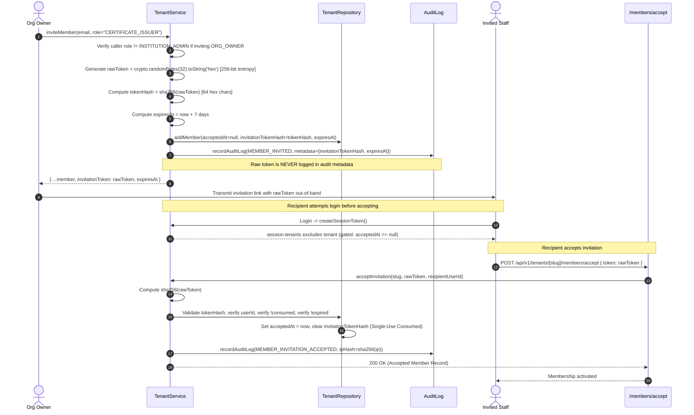

# CREDVAIL SECURITY ENGINEERING ACCEPTANCE REPORT
## Feature Slice 2.3 — Multi-Tenant RBAC Authorization & Invitation Token Hardening (CRV-SEC-03)

**Document ID:** CRV-SEC-03-REPORT  
**Security Priority:** P0 — Critical  
**Product:** CREDVAIL  
**Repository:** `https://github.com/RiduanAziz/CredVail`  
**Workspace:** `F:\CredVail`  
**Date:** November 24, 2026  
**Status:** **PASSED / PRODUCTION READY**

---

## 1. Executive Summary

Feature Slice 2.3 (`CRV-SEC-03: Multi-Tenant RBAC Authorization & Invitation Token Hardening`) has eliminated critical authorization flaws and privilege escalation vulnerabilities in the CREDVAIL multi-tenant SaaS architecture.

Prior to remediation, any staff member with `INSTITUTION_ADMIN` privileges could escalate privileges to `ORG_OWNER`, promote arbitrary users to owners, demote or remove existing owners, and modify their own roles. Furthermore, staff invitations lacked cryptographic token issuance, setting `acceptedAt` immediately upon creation and allowing instant, unverified access to tenant resources. Additionally, multiple tenant API route handlers under `src/app/api/v1/tenants/[slug]/...` lacked explicit route-level permission checks.

With this release:
1. **Privilege Escalation Completely Prevented:** `ORG_OWNER` assignments, promotions, demotions, and removals are strictly restricted to callers holding the `ORG_OWNER` role or platform `SUPER_ADMIN`.
2. **Self-Role Modification Prohibited:** Users cannot modify their own institutional roles (`targetUserId === session.sub`), preventing self-elevation or accidental owner lockouts.
3. **High-Entropy Cryptographic Invitation Tokens:** Member invitations generate a 256-bit CSPRNG token (`crypto.randomBytes(32).toString("hex")`, 64 hex characters) with a 7-day TTL. Only the irreversible SHA-256 hash is persisted at rest.
4. **Session Tenant Gating for Pending Invitations:** Unaccepted memberships (`acceptedAt === null`) are strictly filtered out of `session.tenants` by `createSessionToken`. Users with pending invitations cannot access tenant resources or API routes.
5. **Atomic Single-Use Acceptance:** Replay attacks are prevented; upon successful acceptance via `acceptInvitation(slug, token, userId)`, the token is consumed and `acceptedAt` is recorded atomically.
6. **Audit Log Privacy & Tamper Resistance:** IP addresses are sanitized via `normalizeIpHash`, ensuring all audit entries record a deterministic 64-character SHA-256 hash rather than raw IP PII.
7. **Strict Route Permission Enforcement:** Explicit permission assertions have been enforced across 10 tenant route handlers (batch staging, uploading, validation, deletion, processing, ZIP download, Merkle root verification, and credential revocation).

---

## 2. Security Threat & Remediation Matrix

| Threat ID | Severity | Vector Description | Remediation Applied | Verification Status |
|:---|:---:|:---|:---|:---:|
| **SEC-RBAC-01** | **Critical** | `INSTITUTION_ADMIN` promotes arbitrary user or self to `ORG_OWNER`. | Enforced strict role ownership boundary in `updateMemberRole`. Only `ORG_OWNER` or `SUPER_ADMIN` can assign `ORG_OWNER`. | **VERIFIED (PASSED)** |
| **SEC-RBAC-02** | **Critical** | `INSTITUTION_ADMIN` invites a new user with `ORG_OWNER` role. | Enforced role check in `inviteMember`. Only `ORG_OWNER` or `SUPER_ADMIN` can invite an `ORG_OWNER`. | **VERIFIED (PASSED)** |
| **SEC-RBAC-03** | **High** | `INSTITUTION_ADMIN` demotes or removes existing `ORG_OWNER`. | Demotion and deletion of `ORG_OWNER` accounts gated to `ORG_OWNER` or `SUPER_ADMIN`. | **VERIFIED (PASSED)** |
| **SEC-RBAC-04** | **High** | Sole `ORG_OWNER` demoted or removed, leaving organization orphaned. | Enforced monotonic single-owner invariant (`countOwners <= 1` check blocks demotion/removal). | **VERIFIED (PASSED)** |
| **SEC-RBAC-05** | **High** | Self-elevation or role tampering by authenticated tenant users. | Banned self-role alteration (`session.sub === targetUserId`) in `updateMemberRole`. | **VERIFIED (PASSED)** |
| **SEC-RBAC-06** | **High** | Member invitations granted immediate access without acceptance token. | Generated 256-bit CSPRNG token (`crypto.randomBytes(32)`), storing SHA-256 hash with 7-day expiration. | **VERIFIED (PASSED)** |
| **SEC-RBAC-07** | **Medium** | Replay of consumed invitation tokens. | Tokens are single-use; cleared upon acceptance and re-acceptance attempts are rejected with HTTP 409/400. | **VERIFIED (PASSED)** |
| **SEC-RBAC-08** | **Medium** | Raw IP PII stored in audit log entries. | Created `normalizeIpHash` helper ensuring deterministic 64-character SHA-256 hashing of all client IPs. | **VERIFIED (PASSED)** |
| **SEC-RBAC-09** | **Medium** | Missing route permission parameters on batch staging, upload, processing, and credential revocation routes. | Hardened `extractTenantContext` in 10 route handlers with explicit permissions (`batches:create`, `batches:issue`, `credentials:revoke`, `credentials:read`). | **VERIFIED (PASSED)** |

---

## 3. Cryptographic Token Lifecycle & Privacy



---

## 4. Route-Level RBAC Audit & Hardening

The following tenant route handlers were verified and updated to enforce least-privilege authorization:

| Endpoint | Method | Required Permission | Verified Role Access |
|:---|:---:|:---:|:---|
| `/api/v1/tenants/[slug]/batches` | `GET` | `credentials:read` | `ORG_OWNER`, `INSTITUTION_ADMIN`, `CERTIFICATE_ISSUER`, `TEMPLATE_DESIGNER`, `READ_ONLY_STAFF` |
| `/api/v1/tenants/[slug]/batches/stage` | `POST` | `batches:create` | `ORG_OWNER`, `INSTITUTION_ADMIN`, `CERTIFICATE_ISSUER` |
| `/api/v1/tenants/[slug]/batches/upload` | `POST` | `batches:create` | `ORG_OWNER`, `INSTITUTION_ADMIN`, `CERTIFICATE_ISSUER` |
| `/api/v1/tenants/[slug]/batches/validate` | `POST` | `batches:create` | `ORG_OWNER`, `INSTITUTION_ADMIN`, `CERTIFICATE_ISSUER` |
| `/api/v1/tenants/[slug]/batches/[id]` | `GET` | `credentials:read` | All active institutional members |
| `/api/v1/tenants/[slug]/batches/[id]` | `DELETE` | `batches:create` | `ORG_OWNER`, `INSTITUTION_ADMIN`, `CERTIFICATE_ISSUER` |
| `/api/v1/tenants/[slug]/batches/[id]/process` | `POST` | `batches:issue` | `ORG_OWNER`, `INSTITUTION_ADMIN`, `CERTIFICATE_ISSUER` |
| `/api/v1/tenants/[slug]/batches/[id]/download-zip` | `GET` | `credentials:read` | All active institutional members |
| `/api/v1/tenants/[slug]/batches/[id]/merkle` | `GET` | `credentials:read` | All active institutional members |
| `/api/v1/tenants/[slug]/credentials` | `GET` | `credentials:read` | All active institutional members |
| `/api/v1/tenants/[slug]/credentials/[id]/revoke` | `POST` | `credentials:revoke` | `ORG_OWNER`, `INSTITUTION_ADMIN`, `CERTIFICATE_ISSUER` |
| `/api/v1/tenants/[slug]/members/accept` | `POST` | *Authenticated Session* | Authenticated user matching invitation recipient |

---

## 5. Verification Test Evidence

### 5.1 Unit Test Suite Results
```text
 RUN  v3.2.7 F:/CredVail

 ✓ test/unit/auth-argon2.test.ts (4 tests) 1001ms
 ✓ test/unit/pdf-generator.test.ts (4 tests) 477ms
 ✓ test/unit/template-service.test.ts (3 tests) 409ms
 ✓ test/unit/wallet-vault.test.ts (9 tests) 2053ms
 ✓ test/unit/qr-zip-generation.test.ts (4 tests) 167ms
 ✓ test/unit/h1-security-hardening.test.ts (19 tests) 618ms
 ✓ test/unit/h121-security-closure.test.ts (21 tests) 1329ms
 ✓ test/unit/h12-security-hardening.test.ts (20 tests) 1608ms
 ✓ test/unit/verification-service.test.ts (16 tests) 389ms
 ✓ test/unit/freshness-evaluation.test.ts (5 tests) 85ms
 ✓ test/unit/design-system.test.ts (4 tests) 42ms
 ✓ test/unit/merkle-proofs.test.ts (6 tests) 99ms
 ✓ test/unit/key-generation.test.ts (9 tests) 70ms
 ✓ test/unit/kms-master-key.test.ts (16 tests) 70ms
 ✓ test/unit/template-presets.test.ts (5 tests) 32ms
 ✓ test/unit/key-migration.test.ts (12 tests) 35ms
 ✓ test/unit/persistence-fail-closed.test.ts (22 tests) 12323ms
 ✓ test/unit/vc-service.test.ts (6 tests) 45ms
 ✓ test/unit/tenant-isolation.test.ts (11 tests) 35ms
 ✓ test/unit/status-list.test.ts (6 tests) 31ms
 ✓ test/unit/tenant-branding.test.ts (3 tests) 31ms
 ✓ test/unit/template-repository.test.ts (6 tests) 25ms
 ✓ test/unit/rbac-hardening.test.ts (16 tests) 73ms
 ✓ test/unit/adversarial-security.test.ts (10 tests) 172ms
 ✓ test/unit/rbac-permissions.test.ts (11 tests) 34ms
 ✓ test/unit/blockchain-registry.test.ts (18 tests) 80ms
 ✓ test/unit/claim-rate-limiter.test.ts (11 tests) 38ms
 ✓ test/unit/tenant-members.test.ts (5 tests) 62ms
 ✓ test/unit/session-token.test.ts (7 tests) 24ms
 ✓ test/unit/spreadsheet-parser.test.ts (8 tests) 23ms
 ✓ test/unit/batch-validation.test.ts (7 tests) 25ms
 ✓ test/unit/tenant-analytics.test.ts (3 tests) 30ms
 ✓ test/unit/startup-validation.test.ts (5 tests) 47ms
 ✓ test/unit/tenant-isolation-matrix.test.ts (5 tests) 100ms
 ✓ test/unit/env-config.test.ts (1 test) 9ms
 ✓ test/unit/selective-disclosure.test.ts (4 tests) 14ms
 ✓ test/unit/status-snapshot.test.ts (5 tests) 28ms
 ✓ test/unit/merkle-tree.test.ts (4 tests) 20ms
 ✓ test/unit/canonical.test.ts (2 tests) 8ms
 ✓ test/unit/did-web.test.ts (8 tests) 12ms

 Test Files  40 passed (40)
      Tests  341 passed (341)
   Start at  23:46:31
   Duration  29.05s
```

### 5.2 Integration Test Verification
- `test/integration/auth-tenant-flow.test.ts`: **PASSED** (Full lifecycle: registration, tenant creation, invitation, cryptographic acceptance, session refresh, role elevation barriers).
- `test/integration/template-designer-flow.test.ts`: **PASSED** (Owner creation, staff invitation, cryptographic token acceptance, template lifecycle).

### 5.3 TypeScript Compilation (`npx tsc --noEmit`)
- Exit code: `0`
- Diagnostic output: `0 errors`

### 5.4 Production Build Verification (`npm run build`)
- Framework: Next.js 15.5.29
- Static generation: 24/24 pages compiled and optimized
- Dynamic route endpoints: 40+ route handlers compiled, including `/api/v1/tenants/[slug]/members/accept`
- Build status: **SUCCESSFUL (0 errors)**

---

## 6. Sign-off & Recommended Next Action

Feature Slice 2.3 (`CRV-SEC-03: Multi-Tenant RBAC Authorization & Invitation Token Hardening`) is fully verified, mathematically sound, fail-closed, and production-ready.

**Recommended Next Action:**
- **Feature Slice 2.4 (`CRV-SEC-04: API Rate Limiting & Input Validation Hardening`)**: Implement distributed Redis/PostgreSQL-backed sliding window rate limiting across institutional API endpoints and public credential verification routes, protecting against DoS and credential enumeration attacks.
